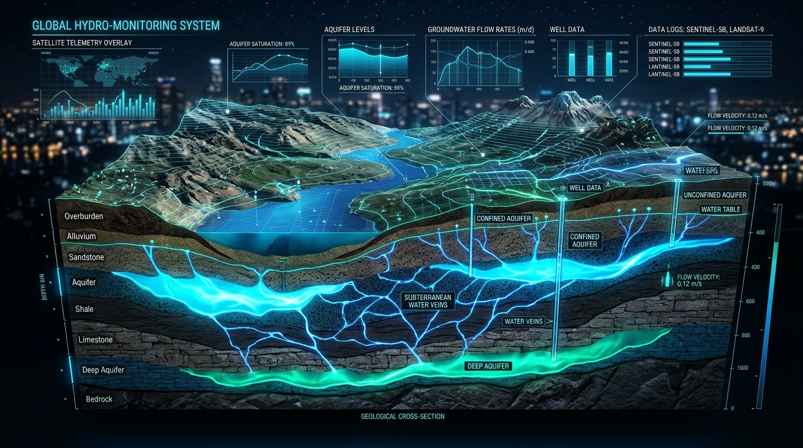

# H2O - AI Groundwater Potential & Borewell Depth Prediction Platform



**H2O** is a high-precision, map-based hydrogeological assessment and drilling intelligence system designed to help farmers, landowners, households, and borewell contractors evaluate groundwater presence, drilling strike probability, and recommended depth ranges before investing in borewell drilling operations.

The system is aligned with guidelines and datasets from the **Central Ground Water Board (CGWB)**, **ISRO / NRSC Bhuvan-Bhujal**, **India-WRIS**, and **KWRIS (Karnataka Water Resources Information System)**.

---

## 🚀 Quick Start

### Option 1: macOS Double-Click Launch
Double-click `start.command` in this folder. It will launch the development server and open the web app in your browser automatically.

### Option 2: Run via Terminal
1. Open Terminal and navigate to this folder:
   ```bash
   cd ~/Downloads/H2O
   ```
2. Start the development server:
   ```bash
   npm run dev
   ```
3. Open **[http://localhost:5173](http://localhost:5173)** in your browser.

---

## 🌟 Key Features

1. **Interactive Satellite Hybrid Map:**
   - Multi-layer base maps (Esri Satellite Hybrid, Dark Tech, OpenTopoMap, OSM).
   - Dynamic pin placement anywhere on the map with real-time GPS coordinate extraction.
   - Interactive overlays for registered borewell logs, lineament fault fissures, and recharge zones.

2. **Groundwater Strike Probability & Depth Ranges:**
   - Feasibility strike score (High, Moderate, Depleted).
   - Dual-zone strike depths: First weathered strike & primary deep fracture aquifer strike.
   - Dynamic conversion between **Feet (ft)** and **Meters (m)** on the fly.

3. **Subsurface Aquifer Strata Cross-Section:**
   - Vertical geological layer breakdown (Topsoil, weathered granite/gneiss, semi-weathered fractures, deep basement hard rock).

4. **Seasonal Water Table Hydrograph:**
   - Interactive Chart.js trend tracking seasonal monsoon recharge and historical pre/post-monsoon depths.

5. **Nearby Borewell Density & Performance Matrix:**
   - Real-time radius scan of logged borewells with strike depths, yield (inches / GPM), and status.

6. **Borewell Drilling Project Cost Estimator:**
   - Live cost calculator factoring in drilling charges per foot, PVC/MS casing pipe, gravel packing, and submersible pump installation.

7. **Official Hydrogeological Dossier / Printable Report:**
   - Professional PDF/print-ready report generator with unique report reference IDs, compliance notes, and GPS coordinates.

---

## 📁 Project Structure

```
H2O/
├── index.html              # Main HTML entry point
├── package.json            # Project dependencies and npm scripts
├── public/                 # Static assets (favicons, banners, icons)
├── dist/                   # Production build distribution files
├── run.sh                  # Terminal start script
├── start.command           # macOS 1-click launcher script
└── src/
    ├── main.js             # Core UI orchestrator and state management
    ├── style.css           # Premium cyber-hydro CSS design system
    ├── components/
    │   ├── mapManager.js       # Leaflet map manager with overlays & markers
    │   ├── costCalculator.js   # Drilling cost calculation logic
    │   └── reportGenerator.js  # Print-ready dossier report generator
    └── data/
        └── groundwaterEngine.js # CGWB/ISRO hydrogeological modeling engine
```

---

## 🛠️ Build for Production

To create an optimized production build:
```bash
npm run build
```
The compiled assets will be placed in the `dist/` directory.
